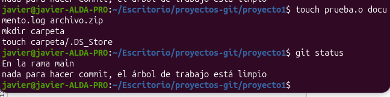
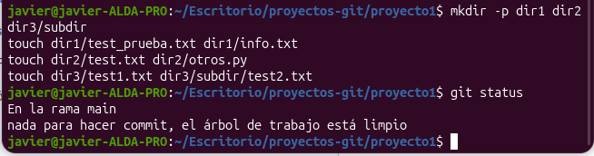
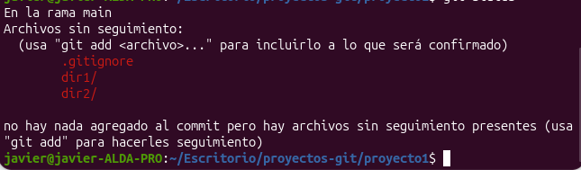

# Práctica 2. Uso avanzado de .gitignore y .gitignore_global en Git

## Comprueba la configuración de tu archivo global.

## Explora los efectos de .gitignore_global:

**Qué patrones he probado y cómo han funcionado:**
He probado patrones generales con comodines (`*.o`, `*.log`, `*.zip`) y el archivo `.DS_Store` en mi archivo `.gitignore_global`. Al crear estos archivos de prueba en el repositorio y ejecutar `git status`, Git no los detecta, confirmando que el árbol de trabajo se mantiene limpio porque estos tipos de archivos han sido ignorados exitosamente a nivel global.

## Explora los efectos de .gitignore local:

**Qué patrones he probado y cómo han funcionado:**
Creamos la estructura de carpetas `dir1`, `dir2`, `dir3` y sus archivos para poner a prueba el `.gitignore` local. 

## Prueba el operador "!" para excluir archivos del ignore.

**Qué patrones he probado y cómo han funcionado:**
Se configuraron las reglas locales:
- `dir2/*.txt` ignoró los archivos de texto de `dir2`, pero dejó sin seguimiento `otros.py`.
- `dir3/**/*.txt` ignoró todos los `.txt` en `dir3` y sus subcarpetas.
- Para `dir1`, combinamos `dir1/*` para ignorar todo su contenido, seguido de `!dir1/info.txt`. Al usar el operador `!`, excluimos ese archivo de ser ignorado, lo que provoca que al hacer `git status` sí aparezca la carpeta `dir1/` lista para añadir.

---

## Diferencias entre ignorar de forma local y global

* **Ignorar de forma Global (`.gitignore_global`):** Esta configuración afecta a todos los repositorios Git de mi ordenador. Sirve para ignorar archivos que son generados automáticamente por mi sistema operativo (como `.DS_Store`) o por mis editores de código, y que nunca voy a querer subir a ningún repositorio. De esta forma, evito tener que escribir estas reglas generales en cada proyecto nuevo.
* **Ignorar de forma Local (`.gitignore`):** Este archivo se encuentra dentro del repositorio actual y sus reglas solo se aplican a este proyecto en concreto. Es útil para ignorar archivos y carpetas que son específicos de la estructura del proyecto en el que estoy trabajando (como ignorar los `.txt` de un directorio concreto pero no de otro).
